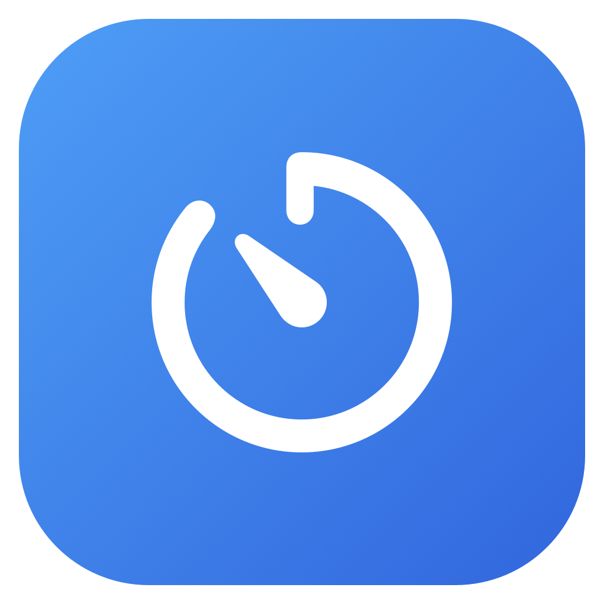

# Menu Bar Timer for Alfred 5 ⏱️

A clean, native, high-visibility macOS menu bar live countdown timer built for **Alfred 5** and standalone power users.



---

## ✨ Features

- **Bold, High-Contrast Menu Bar Pill:** Solid rounded capsule display with an SF Symbol icon, bold white title, and bold golden countdown digits. Never washes out against light or translucent wallpapers.
- **Natural Language Durations:** Start countdowns in plain English: `timer 5m 30s Pasta`, `timer 25m Pomodoro`, `timer 1h 15m Deep Work`, or raw seconds `timer 45s`.
- **Active Timer Manager (`timers`):** Type `timers` in Alfred to view all running countdowns with live remaining time, or press <kbd>Enter</kbd> to cancel any timer instantly.
- **Pause & Resume:** Freeze and resume timers at will from the menu bar dropdown (or press <kbd>p</kbd>). When paused, the pill shifts to an amber warning color and pauses the countdown without losing time.
- **Repeating Alert Sounds:** When time expires, your chosen alert sound loops continuously until you interact with the menu bar item or notification.
- **Click-to-Silence:** Clicking the menu bar item silences the alarm sound immediately.
- **Native Action Notifications:** Notification Center banner with **Repeat** and **End** buttons (no annoying Finder "Show" button).
- **Sound Configuration:** Choose your default alarm audio (`Radar`, `Alarm`, `Hero`, `Glass`, `Ping`, `Sosumi`, `Submarine`) directly in Alfred 5 Workflow Preferences.
- **Accessory App:** Zero Dock clutter (`LSUIElement = true`).

---

## 🚀 Installation

### 1. Download & Double-Click
1. Download the latest `MenuBarTimer.alfredworkflow` from [GitHub Releases](https://github.com/gedeyenite/Alfred_Timer/releases).
2. Double-click the `.alfredworkflow` file to import it into Alfred 5.

### 2. Configure Notification Permissions (Important!)
To ensure timer expiry alerts pop up over full-screen apps and lock screens:
1. Open **System Settings** → **Notifications** → **MenuBarTimer**.
2. Set alert style to **Alerts** (persistent until dismissed).
3. Enable **Play sound for notification**.

---

## ⌨️ Usage

### Start a Timer (`timer`)
Open Alfred (<kbd>⌘ Space</kbd>) and type:

```text
timer 5m Pasta
timer 25m Pomodoro
timer 1h 15m Code Review
timer 45s Tea Steep
timer 300 Break
```

### View & Manage Running Timers (`timers`)
Open Alfred and type:

```text
timers
```

- Lists all active countdowns with real-time remaining time.
- Press <kbd>Enter</kbd> on any countdown to cancel it immediately.
- Type `timers <keyword>` (e.g. `timers tea`) to filter when multiple timers are running.

### Menu Bar Dropdown Controls
Clicking any active timer pill in the macOS menu bar reveals:
- **Timer Label & Status**
- **Pause Timer / Resume Timer** (<kbd>p</kbd>)
- **Repeat Timer** (<kbd>r</kbd>)
- **End Timer** (<kbd>q</kbd>)

---

## ⚙️ Configuration in Alfred

In Alfred Preferences → **Workflows** → **Menu Bar Timer**, click the **Configure Workflow** button to:
- Select your preferred **Alert Sound** (`Radar` is default).
- Change default keywords if desired.

---

## 🛠️ Building from Source

Requirements: macOS 12+ and Xcode Command Line Tools (`xcode-select --install`).

Clone and run the automated build script:

```bash
git clone https://github.com/gedeyenite/Alfred_Timer.git
cd Alfred_Timer
./build.sh
```

This compiles `MenuBarTimer.swift`, bundles `MenuBarTimer.app`, codesigns it, installs it to `/Applications`, and generates the self-contained `dist/MenuBarTimer.alfredworkflow`.

---

## 📄 License

MIT © Stephen Murphy
